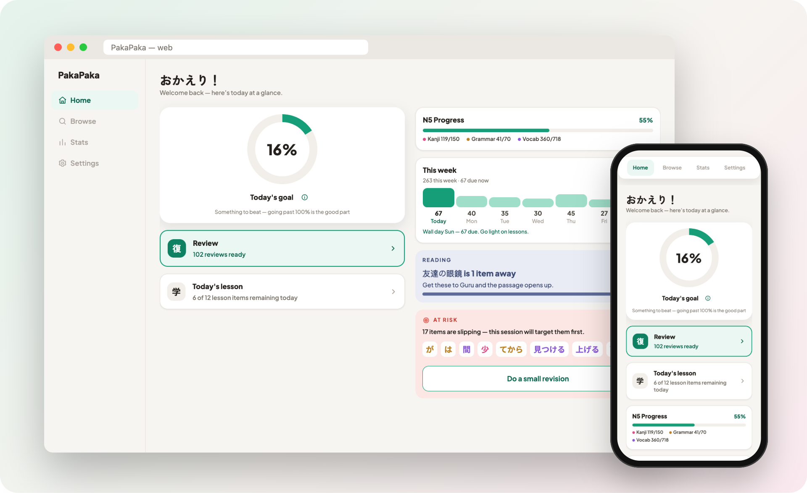
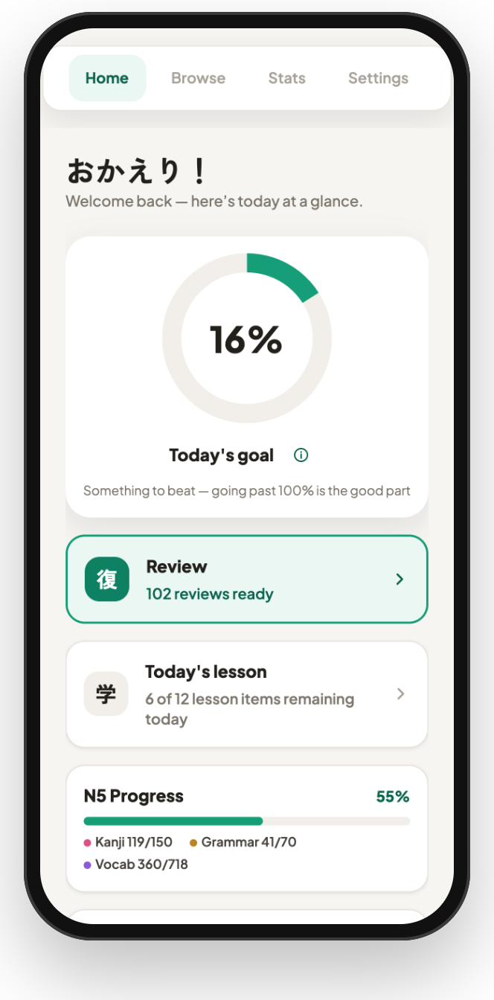
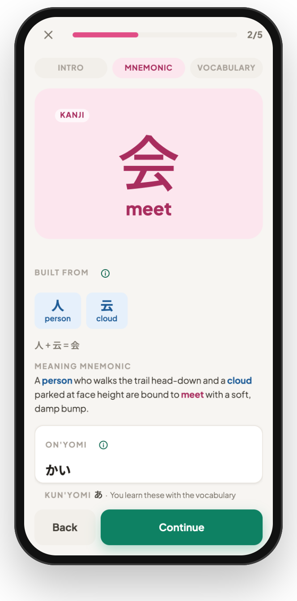
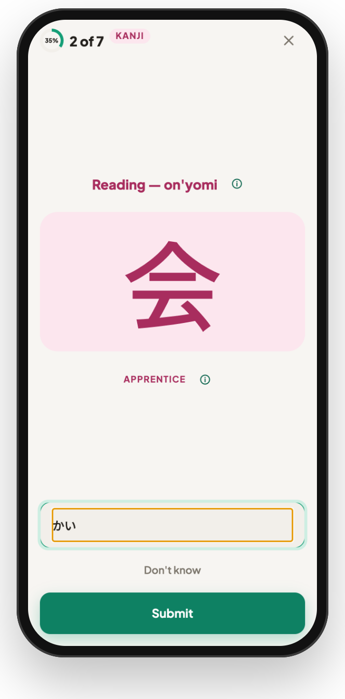
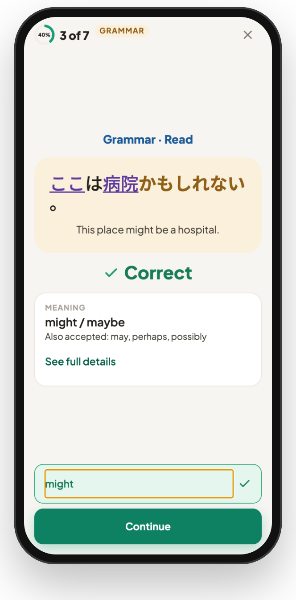
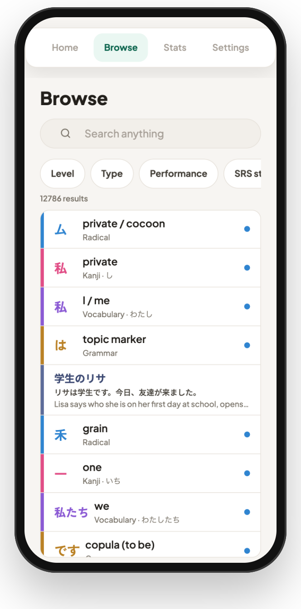
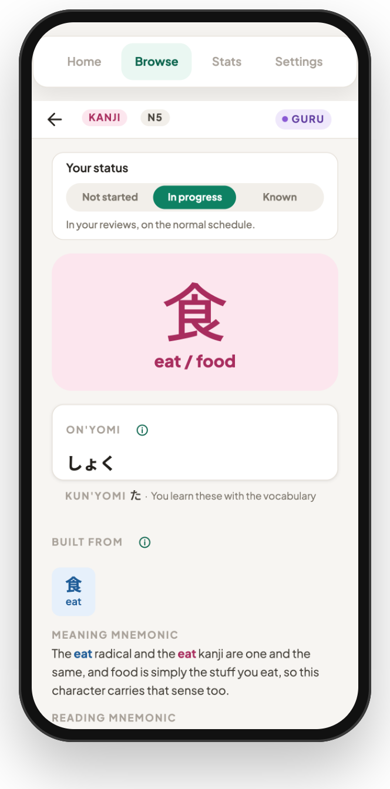
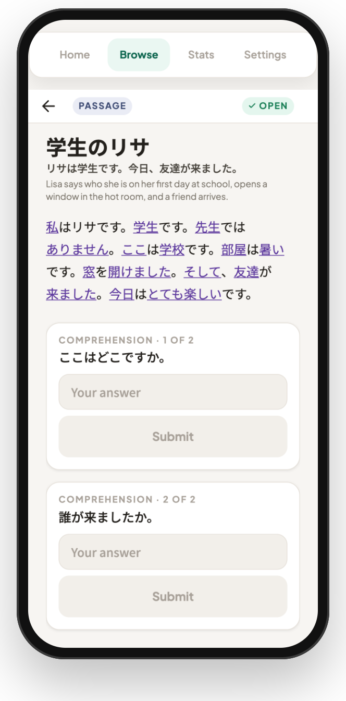
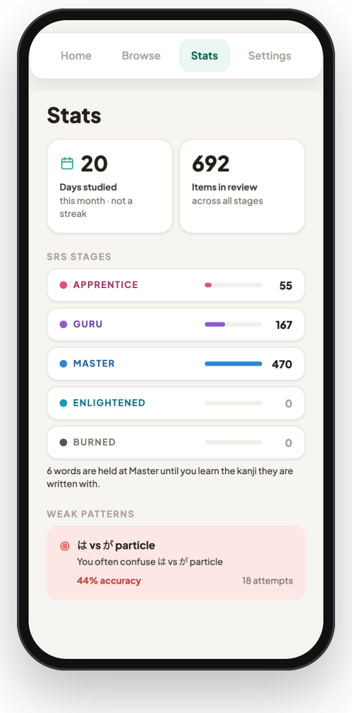

<p align="center">
  
</p>

<h1 align="center">PakaPaka</h1>

<p align="center">
  <strong>Learn Japanese with mnemonics and typed answers.</strong><br />
  Kanji, vocabulary, grammar and reading in one app. Free, open source, and works offline.
</p>

<p align="center">
  <a href="https://paka-paka.app/"><strong>Try the beta in your browser at paka-paka.app →</strong></a>
</p>

<p align="center">
  
  
  
  
  
</p>

<p align="center">
  <picture>
    <source media="(prefers-color-scheme: dark)" srcset="docs/screenshots/hero-dark.png" />
    
  </picture>
</p>

---

PakaPaka teaches Japanese in the WaniKani style, and adds grammar and reading. Every radical, kanji and word comes with a **mnemonic**: a short story that ties its shape to its meaning and reading. In reviews you **type every answer**. There is no multiple choice, so you recall the answer instead of only recognizing it.

Radicals, kanji, vocabulary, grammar and reading passages sit in one dependency graph and go through one review queue. The queue learns where you make mistakes and shows you those items first.

**No account needed. No subscriptions. No ads.** Your progress stays on your device. If you want it on more than one device, you can sign in with Google and sync it.

<table align="center">
  <tr>
    <td align="center" width="25%"><br /><sub><b>Home</b><br />Today's goal, reviews and lesson</sub></td>
    <td align="center" width="25%"><br /><sub><b>Lessons</b><br />Parts, mnemonic and reading</sub></td>
    <td align="center" width="25%"><br /><sub><b>Reviews</b><br />Type the answer, romaji becomes kana</sub></td>
    <td align="center" width="25%"><br /><sub><b>Grammar</b><br />Read and Build cards</sub></td>
  </tr>
  <tr>
    <td align="center"><br /><sub><b>Browse</b><br />Every item and passage in one list</sub></td>
    <td align="center"><br /><sub><b>Item details</b><br />Readings, parts and mnemonics</sub></td>
    <td align="center"><br /><sub><b>Reading</b><br />Passages open as you learn their words</sub></td>
    <td align="center"><br /><sub><b>Stats</b><br />SRS stages and weak patterns</sub></td>
  </tr>
</table>

## Features

- **Mnemonics for everything.** Each radical, kanji and word has a mnemonic for its meaning, and for its reading where the sound needs one. Grammar points have one too. You can add your own.
- **You type the answer.** Type the meaning or the reading. Romaji turns into kana as you type. The app catches typos, wrong-script answers and answers that belong to a different item.
- **One path, in the right order.** Radicals unlock kanji. Kanji unlock vocabulary. Vocabulary and grammar unlock reading. You never study a word before its parts.
- **Reviews that find your weak points.** Scheduling uses [FSRS](https://github.com/open-spaced-repetition/ts-fsrs), blended with a weakness score from your real mistakes.
- **Grammar you use.** **Read** cards: type what the grammar means in a Japanese sentence. **Build** cards: type the full Japanese sentence from English.
- **Reading passages.** Graded stories open when you know 90% of their words. Furigana hides for words you know.
- **Talk.** Practice conversation with an AI partner at your level, in the phone app. Bring your own API key (OpenAI-compatible or Anthropic). Needs a network.
- **Works offline.** In the phone app, lessons, reviews, Browse and Stats work with no network. Only Talk and sync need one. The web app needs a connection to open the page.
- **Optional sign-in and sync.** Sign in with Google to back up your progress and use it on the web and on your phone. If you never sign in, nothing leaves your device.
- **Bring your history.** Import progress from WaniKani, Bunpro or Anki, or restore a PakaPaka backup.

For a full tour of the app, see [docs/app-overview.md](docs/app-overview.md).

## What is in the curriculum

| Radicals | Kanji | Vocabulary | Grammar points | Reading passages |
| --- | --- | --- | --- | --- |
| 817 | 2,000 | 9,747 | 161 | 60 |

**N5 and N4 are complete:** mnemonics, example sentences, grammar and reading passages.
**N3, N2 and N1 are a first version:** kanji, radicals and words with readings and meanings. Mnemonics, examples, grammar and passages for these levels are not written yet. This is a good place to contribute.

## Try it

PakaPaka is in **beta**. It is still in development, so expect changes and some rough edges. Please report bugs in [Issues](https://github.com/riyaz942/pakapaka/issues).

**On the web:** open [paka-paka.app](https://paka-paka.app/). No install is needed. Your progress is stored in your browser.

**On your phone:** PakaPaka is not in the App Store or Google Play yet. To try it now, build it from source:

```bash
git clone https://github.com/riyaz942/pakapaka.git
cd pakapaka
git lfs install && git lfs pull
cd mobile && npm install
npx expo run:ios       # or: npx expo run:android
```

For full setup, other ways to run the app, and the curriculum pipeline, see [docs/development.md](docs/development.md).

## Contributing

Contributions are welcome: code, curriculum content, mnemonics and bug reports. See [CONTRIBUTING.md](CONTRIBUTING.md).

## Documentation

- [docs/app-overview.md](docs/app-overview.md) — what the app is, how a learner moves through it, what each screen does
- [docs/development.md](docs/development.md) — setup, build, run, CI
- [docs/working-history.md](docs/working-history.md) — status of every plan: what is done and what is left
- [docs/srs-system-vs-wanikani.md](docs/srs-system-vs-wanikani.md) — how SRS stages work, compared with WaniKani
- [docs/README.md](docs/README.md) — index of all working docs

## License

- **Code** is licensed under the [MIT License](LICENSE).
- **Curriculum content** (`curriculum/` and the compiled `curriculum.db`) contains data derived from JMdict, KANJIDIC2, KRADFILE and JmdictFurigana, and is licensed under [CC BY-SA 4.0](https://creativecommons.org/licenses/by-sa/4.0/).
- **Stroke-order data and kanji/radical images** are derived from [KanjiVG](https://kanjivg.tagaini.net/) and are licensed under [CC BY-SA 3.0](https://creativecommons.org/licenses/by-sa/3.0/).

See [NOTICE](NOTICE) for the full third-party attributions. The app also shows them in **Settings → About and data sources**.

## Acknowledgements

Thank you to the [EDRDG](https://www.edrdg.org/) (JMdict, KANJIDIC2, KRADFILE), [JmdictFurigana](https://github.com/Doublevil/JmdictFurigana), [KanjiVG](https://kanjivg.tagaini.net/), [Tatoeba](https://tatoeba.org/) and the [open-spaced-repetition](https://github.com/open-spaced-repetition) project. This app would not exist without their work.
