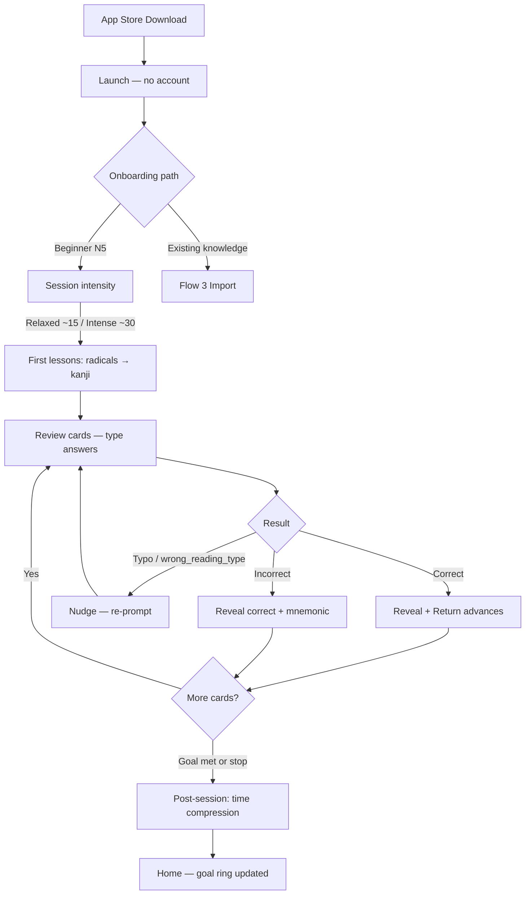
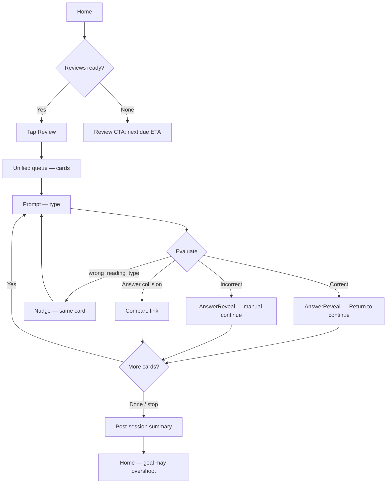
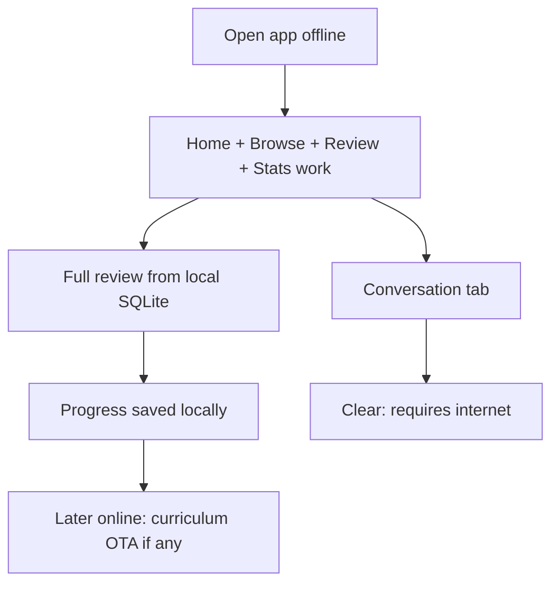
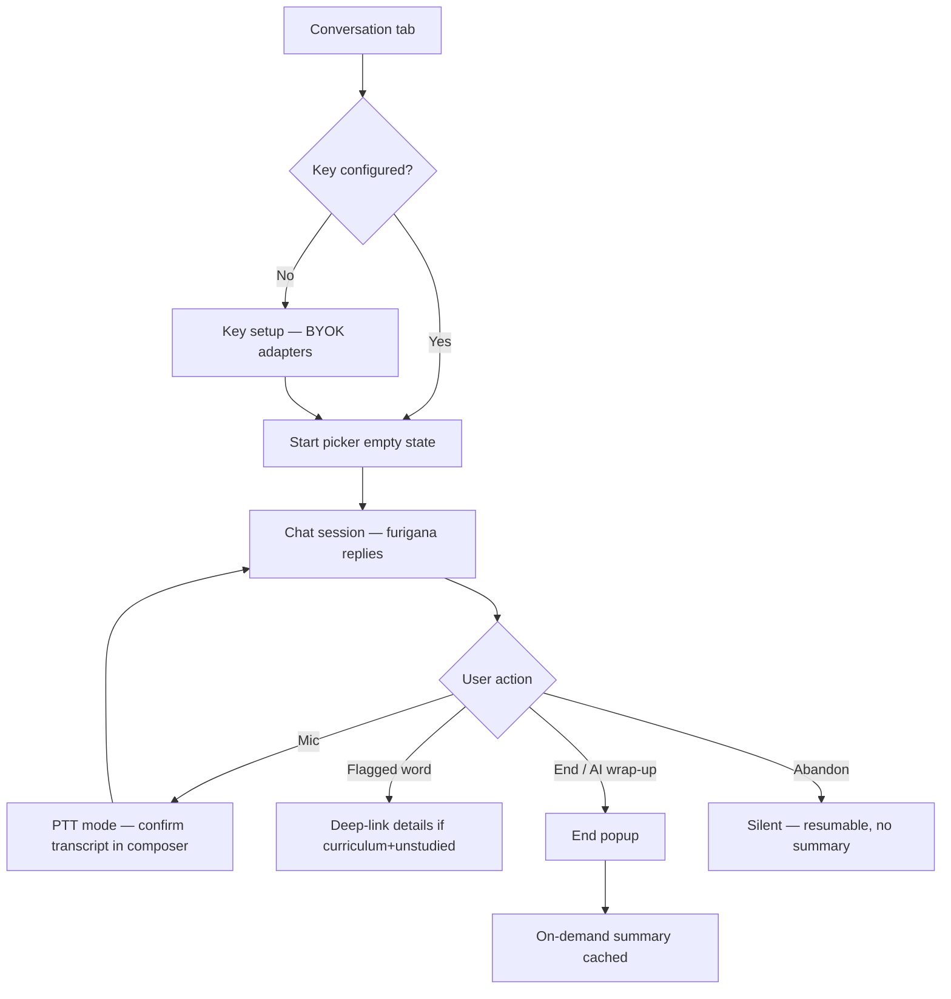

# UX Design Specification japanese-learning

**Author:** Riyaz
**Date:** 2026-05-02 (v1) · **Updated:** 2026-07-20 (v2 — PRD Revision v2 + design directions reconciliation)
**Status:** final

> **Spine rule (v2):** Where PRD v2 (FR55–FR100, R1–R4) conflicts with the May 2026 UX spine or `ux-design-directions.html` mockups, **PRD v2 wins on IA and behavior**. Design directions own visual density/tokens where compatible (Direction A compact review, progressive grammar hints, dark token system, time-compression post-session, import trust). Fast-path assumptions were confirmed 2026-07-20 (see Confirmed Decisions).

---

## Executive Summary

### Project Vision

japanese-learning is a free, open-source, cross-platform mobile app (Android & iOS) that replaces the fragmented, expensive multi-tool stack serious Japanese learners assemble today. It matches WaniKani on kanji depth and Bunpro on grammar depth, then surpasses them with a weakness detection engine that targets what the learner struggles with, visible cross-domain reinforcement that shows kanji/vocabulary/grammar connections explicitly, and a time compression display that proves the app is faster than a multi-app stack on every session. Seamless WaniKani, Bunpro, and Anki import eliminates switching risk. All data is local-first and offline-capable for core study. No accounts, no subscriptions, no ads.

v2 adds a **unified Browse/Search** discovery surface (passages live here — no dedicated Read tab), reframes the daily ring as an adaptive **goal** (not a capacity ceiling), and introduces an **AI Conversation** tab for curriculum-grounded Japanese practice (BYOK; chat default, optional on-device voice).

The UX must embody "serious tool, not a toy" — keyboard-first review input, <100ms review feedback, dense information-rich screens, and zero animations in the review loop. The app respects the learner's time and intelligence while making its adaptive intelligence visible and felt. Conversation practice is a deliberate parallel surface — coach-smart in study, conversational when the learner chooses to speak.

### Target Users

**Yuki (Anime/Manga Self-Learner):** 18-28, budget-conscious, motivated by consuming Japanese media in the original language. Hit a wall with shallow tools like Duolingo. Wants structured depth for free. 15-30 min daily sessions on mobile. Values feeling like they proved something each session — goal ring fill + time compression, not streak guilt.

**Kenji (Relocating Professional):** 25-40, needs practical Japanese fast for daily life in Japan. Limited free time, strong practical motivation. Studies on the train (offline-critical for review/learn). Needs the app to tell them what to study next without overthinking curriculum. Conversation when online is a bonus, never a gate.

**Mika (JLPT Test Prepper / Switcher):** Any age, studying for a specific JLPT level (N3-N1) or migrating from WaniKani/Bunpro. Disciplined, goal-oriented. Frustrated by paying $150-450/year across multiple subscriptions that don't communicate. Needs all JLPT domains in one place with input-based testing that builds real exam confidence, plus import that proves nothing was lost.

**Riyaz (The Switcher):** Active WaniKani user who wants grammar at the same quality without another subscription. Fears losing accumulated progress. Technically savvy. Needs seamless import, first session calibrated to their level, and optional BYOK conversation without handing learning data to a vendor they didn't choose.

### Key Design Challenges

1. **The review loop is the product.** The show → type → result → next cycle must feel faster than WaniKani. <100ms feedback, keyboard-first, zero animations in the review loop. Kanji now use a **two-card model** (meaning + on'yomi) with Return-to-advance pacing — session length roughly doubles; the loop must stay frictionless anyway.

2. **Making intelligence visible without noise.** Weakness detection, cross-domain reinforcement, and time compression must be felt — without slowing the review loop or cluttering dense screens.

3. **Goal ring as a novel paradigm (reframed).** The ring is an adaptive **daily goal** that fills from lessons *and* reviews, may overshoot 100%, and has no maximum. Users must understand it as aspiration, not a stop sign — informational, never restrictive.

4. **Onboarding complexity for switchers.** Importing from WaniKani/Bunpro/Anki must feel effortless and trustworthy. If a switcher's first session feels like a beginner experience, the import failed.

5. **Discovery without a Read tab.** Passages, lessons, and item browsing collapse into one Browse/Search surface with faceted filters and lock states that read as to-do lists, not dead ends.

6. **AI Conversation without breaking trust.** BYOK, deferred correction, curriculum-grounded replies, offline exception messaging, and large on-device model downloads must feel honest and optional — never a second product bolted on.

### Design Opportunities

1. **Post-session summary as a viral moment.** Time compression ("18 min → ~35-40 min across separate apps") plus domain breakdown remains screenshot-worthy.

2. **Visible reinforcement as the "aha" differentiator.** Grammar progressive hints + post-answer "食べる ← you learned this yesterday" remain the emotional switching trigger.

3. **Goal ring as brand identity.** The ring stays the app's visual signature — fitness-tracker-for-your-brain — now with overshoot as a proud overflow, not a ceiling breach.

4. **Conversation end-summary as a second "aha".** Deferred correction (≤5 mistakes worth fixing, words met, grammar practised) turns chat into felt coaching without interrupting flow.

5. **Browse as one discovery surface.** Fan-out search + faceted filters + passages-as-rows makes "find anything I need" a single habit.

## Core User Experience

### Defining Experience

The core experience of japanese-learning is the **unified review session** — a tight, keyboard-first loop of show → type → result → next that interleaves kanji, vocabulary, and grammar in a single stream. This is where 80%+ of daily usage lives. Every other feature — onboarding, import, Browse, Conversation, stats — exists to serve, feed, or enhance this loop (or, for Conversation, to practise what the loop taught).

The review loop must feel faster than WaniKani, denser than Bunpro, and more structured than Anki. The user types an answer, gets instant feedback (<100ms), and advances with **Return** (auto-advance is opt-in, off by default). No menus between items, no animations that delay the next card, no decision points mid-session.

What makes this loop different: intelligence is visible. Weakness-targeted items appear more often; cross-domain connections surface via progressive hints / result notes; the **goal ring** fills as they study — from both lessons and reviews — and may proudly overshoot. Home **offers** Review and Learn; it never auto-starts a session.

### Platform Strategy

**Primary platform:** Mobile (Android & iOS via React Native / Expo) from a single codebase.

**Minimum OS (v2):** iOS 17 / Android 13 (API 33) — whole-app launch constraint for the on-device voice stack (NFR23). Older v1 floors are retired.

**Input model:** Touch for navigation, keyboard-first for the review loop. Japanese text input via embedded WanaKana (romaji → hiragana). Conversation mode uses push-to-talk with on-device STT; transcription lands in the composer for confirm/edit before send.

**Offline-first (with one exception):** All SRS review, FSRS, weakness detection, goal tracking, Browse/passages, and lessons work fully offline after initial content download. **AI Conversation requires network** (NFR24) and must say so clearly. Network also needed for curriculum OTA updates, mnemonic image fetch (cached), one-time imports, and optional cloud STT (explicit opt-in only).

**Session context:** 15–30 minute sessions. Cold start to first interactive screen within 3 seconds. Tap Review → first card with no intermediate screens.

**Desktop (post-MVP):** Electron + React Native Web — same experience, deferred.

### Effortless Interactions

**Starting a review:** Tap "Review" on Home → first card instantly. App decides the queue (FSRS + weakness + interleaving). User decision is binary: start, or don't.

**Japanese text input:** Romaji→hiragana in real time. Fat-finger tolerance via Levenshtein; `wrong_reading_type` / `wrong_script` are non-terminal nudges, not grades.

**Knowing what to study:** FSRS, weakness, and the dependency graph remove curriculum decision fatigue. Browse is for deliberate discovery; Home is for today's offers.

**Ending a session:** Goal ring fills from lessons and reviews. At/over 100% signals "goal met" — user can always continue. No "200 reviews pending" anxiety on Home; welcome-back triage softens returns after absence.

**Progress import:** API key / file → transparent summary → calibrated first session. Burned stays burned.

**Starting a conversation:** Conversation tab → start picker (or key setup if unconfigured) → chat default; mic promotes to voice mid-session. End → on-demand summary. Never mid-convo correction.

### Critical Success Moments

**First session (Day 1):** First review — radicals with mnemonics, input testing, instant feedback. Goal ring moves. Post-session shows time compression. User closes feeling accomplished, not behind.

**The "aha" moment (Week 1–2):** Grammar sentence highlights "← you learned this yesterday" (via hint ladder or result). Weakness engine drills て-form. App feels like it's paying attention.

**The time compression proof (every session):** Domain breakdown + "18 min — equivalent to ~35–40 min across separate apps."

**Import trust (switchers, Day 1):** First review at actual level. Burned kanji don't appear as new. "It already knows what I know."

**Weakness improvement (Month 1+):** Stats show "て-form accuracy: 45% → 78%." Measurable proof.

**Conversation payoff (when configured):** End-of-session summary lists ≤5 fixes and words met — coaching after the talk, not during it.

### Experience Principles

1. **Speed is respect.** <100ms feedback. No animations in the review loop. No intermediate screens. Return advances; auto-advance is opt-in.

2. **Intelligence must be felt, not claimed.** Every adaptive behavior needs a visible signal — highlight, targeting, time savings, end-summary.

3. **Inform, don't restrict.** Goal ring recommends; never forces stop. Overshoot is allowed. Locked passages show a to-do list, not a dead end. Home offers; never auto-starts.

4. **Zero decisions during review.** Recall and type only. What/when/order — the app decides.

5. **Prove the value on every session.** Time compression daily. Weakness trends weekly. Reinforcement in real time. Conversation summaries on demand.

6. **Network is the exception.** Offline is the default for study. Conversation is the honest exception — labeled, never silent failure.

## Desired Emotional Response

### Primary Emotional Goals

**Focused mastery:** Flow during review — quiet satisfaction of proving knowledge through typing. Not gamified excitement, not dread.

**Felt intelligence:** Coach-smart in study (targeted, personal, measured). Conversation is a *chosen* practice mode — warm, curriculum-grounded, never a nagging tutor mid-sentence.

**Vindication:** "I was paying $168/year and this free thing is smarter." Time compression triggers this every session.

### Emotional Journey Mapping

| Stage | Primary Emotion | Supporting Emotions | Design Implication |
| --- | --- | --- | --- |
| **Discovery / First launch** | Curiosity + relief | "This is free? And it covers everything?" | Clean onboarding, no paywall, immediate credibility |
| **During review** | Focused flow | Quiet confidence | Distraction-free loop, <100ms feedback |
| **Correct answer** | Brief satisfaction | Momentum | Return-to-advance is the reward; no celebration animations |
| **Wrong answer** | Clarity without shame | Acceptance | "Close!" / wrong_reading_type teach, don't punish |
| **Goal ring fills / overshoots** | Accomplishment | Optional pride in overshoot | "Goal met" / overflow feels earned, not capped |
| **Post-session summary** | Vindication + momentum | Value confirmation | Time compression + domain breakdown |
| **"Aha" (Week 1–2)** | Surprise + trust | Connection | Visible reinforcement |
| **Conversation end summary** | Clarity + coaching | Safety | Corrections after the talk |
| **Returning daily** | Ritual comfort | Trust | Goal framing, not streak dread; welcome-back triage after absence |

### Micro-Emotions

**Confidence vs. Confusion:** Prompt type must be instantly parseable — especially **"Reading — on'yomi"** vs meaning vs cloze.

**Trust vs. Skepticism:** Time compression conservative; import transparent; BYOK costs legible; Conversation never corrects mid-flow.

**Accomplishment vs. Frustration:** Goal met reframes stopping. Errors feed weakness / deferred conversation fixes.

**Momentum vs. Anxiety:** No Home streak. No streak-at-risk notifications. No raw overdue mountain — welcome-back shows a slice ("20 of your 340 due").

### Design Implications

**Focused mastery → Distraction-free review.** No confetti. Reward = next card (via Return).

**Felt intelligence → Visible adaptive signals.** Targeting, reinforcement, time proof, conversation end-summary.

**Vindication → Screenshot-worthy post-session.** Time compression centerpiece (Direction D).

**Permission → Non-restrictive goal ring.** Fitness-tracker aesthetic; overshoot allowed; Settings unbounded goal.

**Clarity without shame → Constructive errors.** Immediate correct answer; typo vs knowledge gap vs wrong reading type.

### Emotional Design Principles

1. **Earned satisfaction, not manufactured delight.** No XP, gems, leaderboards, confetti. Real progress is the motivation. **Streak is not a Home habit driver** (R2).

2. **Speed is the primary emotional signal.** Instant feedback = respect.

3. **Errors are data, not failures.** Wrong answers feed weakness; conversation mistakes wait for the summary.

4. **Prove, don't promise.** Visible evidence inside the app.

5. **Permission to stop is permission to return.** Goal met / overshoot beats "187 still pending." Welcome-back triage after absence.

## UX Pattern Analysis & Inspiration

### Inspiring Products Analysis

**WaniKani — Input-Based Kanji SRS**

*Take:* Review loop speed, input-based testing, dependency graph UX, SRS stage visibility.
*Fix:* Goal ring replaces pending-counter anxiety; weakness targeting; cross-domain scope; import for switchers; typed reading type (on'yomi labeled) instead of flattened readings.

**Bunpro — Grammar SRS**

*Take:* JLPT grammar progression, cloze testing, multiple examples.
*Fix:* Clean review loop; conjugation-aware validation; visible reinforcement; progressive hints instead of cluttered always-on chrome.

**Apple Watch Activity Rings / WHOOP Strain**

*Take:* Ring as primary progress viz; informational tone; progressive adaptation; screenshot-worthy completion.
*Adapt (v2):* Ring is a **goal** that may **overshoot 100%** — overflow is proud, not an error. Weekly ratchet rises only; opt-in reduction after misses. Never nag notifications tied to ring status.
*Fix:* Inform, don't restrict. No "close your rings" guilt.

**Duolingo — Gamified Language Learning**

*Take:* Frictionless onboarding (no account, fast time-to-value); gentle error recovery; clear next action.
*Avoid:* XP/gems/leaderboards; celebratory review animations; multiple-choice as primary; **streak anxiety / streak-at-risk nags** (explicitly rejected in v2).
*Note:* v1 "simple streak mechanic" inspiration is **retired for Home**. Stats may still show **days studied this month** as a calm activity signal — not a flame counter.

### Transferable UX Patterns

- **WaniKani dashboard → review:** One tap into review; distraction-free session.
- **WHOOP/ring fill:** Continuous goal progress during the day (lessons + reviews).
- **Bunpro cloze:** Grammar in context.
- **WHOOP data-rich dark aesthetic:** Serious tool, not toy.
- **WaniKani SRS colors:** Apprentice → Burned vocabulary.

### Anti-Patterns to Avoid

1. **"200 reviews pending" as primary Home metric** — goal ring + offers instead.
2. **Celebratory animations in the review loop.**
3. **Inconsistent answer validation** (false rejections).
4. **Gamification as motivation substitute** (XP, gems, leaderboards, Home streaks).
5. **Cluttered review screens** — prompt, input, result (+ optional Hint) only.
6. **Rigid Level-1 restart for switchers.**
7. **Mid-conversation AI correction** — deferred to end summary only.
8. **Silent offline failure on Conversation** — say "requires internet."
9. **Locked passage as dead end** — always show the to-do list of needed items.
10. **Gesture-only long-press** — always provide a non-gesture a11y alternative (NFR29).

### Design Inspiration Strategy

| Adopt | Source | Why |
| --- | --- | --- |
| Type-and-submit review loop | WaniKani | Fastest SRS pattern; users already trained |
| Ring-based progress | Apple Watch / WHOOP | Legible, emotional, screenshot-worthy |
| Frictionless onboarding | Duolingo | No account, immediate value |
| JLPT grammar progression + cloze | Bunpro | Expected framework + contextual testing |
| SRS stage color coding | WaniKani | Mastery at a glance |

| Adapt | How |
| --- | --- |
| Ring fill | Goal (not ceiling); overshoot OK; fills from lessons + reviews |
| Home composition | Permanent sections + empty states; forecast wall; reading readiness; conditional at-risk / welcome-back (FR58–61) |
| Error feedback | Gentle + diagnostic (`close!`, `wrong_reading_type`, answer-collision → Compare) |
| Data-rich aesthetic | Dark-first WHOOP tone; NativeWind tokens |

| Avoid | Conflict |
| --- | --- |
| XP / gems / leaderboards / Home streak | Earned satisfaction; R2 |
| Pending counter as primary | Permission to return |
| Review-loop celebrations | Speed is respect |
| Mid-convo AI tutoring | FR95 |

## Design System Foundation

### Design System Choice

**NativeWind (Tailwind CSS for React Native)** — utility-first styling with a custom design token layer and hand-built components.

### Rationale for Selection

1. No component library matches the "serious tool / WHOOP" aesthetic without heavy fighting.
2. Core components (goal ring, review cards, reinforcement, WanaKana, time compression, Browse rows, Conversation composer) are custom anyway.
3. Utility-first is fast for solo iteration.
4. Compiles to StyleSheet — supports <100ms review target.
5. Dark mode is native.

### Implementation Approach

**Foundation:** NativeWind v4+ · custom `tailwind.config.js` · dark default, light secondary.

**Tokens:** Background tiers; SRS accents; feedback colors; **goal-ring** gradient (green → yellow → orange → complete cyan); content-type accents; reinforcement muted pair.

**Typography / spacing:** System fonts; steep hierarchy; 4px base; dense in review, comfortable elsewhere.

**Animation:** Zero in review loop. Subtle ring fill and non-review transitions only; interruptible; reducible via a11y settings.

**Custom library (core):** `GoalRing` (was CognitiveLoadRing), `ReviewCard`, `WanaKanaInput`, `ProgressiveHint`, `ReinforcementHighlight`, `AnswerReveal`, `TimeCompressionSummary`, `BrowseList` / filter chips, `ConversationComposer`, `FuriganaText` (shared), `SectionHeading`, `CompareView`, `ImportSummaryCard`, `WeaknessStatCard`, `TabBar`.

### Customization Strategy

`tailwind.config.js` is single source of truth. Compose, don't inherit. `Platform.select()` for platform deltas. A11y props baked into every component from day one. Contrast validated against token pairings (CI `check-contrast`).

## Defining Core Experience

### Defining Experience

**"Type → prove → see the connections."** (Study)

Plus, when chosen: **"Speak / chat → get coached at the end."** (Conversation)

The defining study experience is input-based proving with felt cross-domain intelligence. Conversation is a first-class practice surface, not a replacement for the review loop.

### User Mental Model

**Switchers:** Expect WaniKani loop + SRS stages + JLPT. Surprise: goal ring, weakness targeting, reinforcement, Browse-with-passages, optional Conversation.

**Beginners:** Expect a clear path. Frame typing as proof of real learning. Goal ring feels familiar from fitness apps.

**Shared:**
- Open → offered next action → do it → close.
- Wrong → see it again sooner.
- Progress visible (goal, JLPT progress, Stats days-studied — **not** a Home streak flame).
- Japanese input just works.
- Conversation needs network and a key — that's expected for LLM features.

**Confusion risks to design away:**
- Reading type labels (on'yomi vs meaning).
- Goal ring vs "stop" — overshoot and continue must be obvious.
- Browse lock = passages only (kanji/vocab/grammar always viewable).
- Details page ≠ lesson entry point.
- Furigana tap = peek; Settings holds persistent overrides.

### Success Criteria

1. Review loop feels ≥ WaniKani speed (<100ms feedback).
2. Intelligence noticed within first week (reinforcement, targeting, time compression).
3. Sessions complete via goal framing — track **goal-ring completion rate + overshoot rate** (replaces v1 "80% within capacity ceiling").
4. Switchers don't miss old tools after one week.
5. Users can describe the app in one sentence including "targets my weak spots" and/or "kanji + grammar together."
6. **Active study days per month at D30** (replaces streak maintenance KPI).

### Novel UX Patterns

**Established:** Input SRS loop, JLPT progression, romaji→hiragana, SRS colors.

**Novel:**
1. **Goal ring** (adaptive, overshootable) — fitness metaphor transferred to study load from lessons + reviews.
2. **Visible cross-domain reinforcement** with grammar **progressive Hint** exception on the prompt.
3. **Time compression** post-session comparison framing.
4. **Two-card kanji + Return-advances** — one item, two prompts, worst-of-both SRS, card-counted progress.
5. **Unified Browse** with passages as first-class rows and 90% Guru+ unlock.
6. **Deferred-correction Conversation** with furigana-bracket AI replies and BYOK.

### Experience Mechanics

**1. Initiation (Home):** Greeting + goal ring + Learn CTA + Review CTA + one-week forecast (wall on heavy days) + reading readiness. Conditional: at-risk refresher, welcome-back, curriculum banner, import nudge. User chooses mode — Home never auto-starts.

**2. Review loop:**
- Prompt with type badge; kanji reading labeled **"Reading — on'yomi"**; meaning card separate.
- Type via WanaKana / English as appropriate.
- Result <100ms; shared `AnswerReveal` (reading + meaning) on correct *and* incorrect paths.
- `wrong_reading_type` → nudge, re-prompt, no grade.
- Answer-collision → reveal line + link to Compare (both items preselected).
- Grammar: ProgressiveHint on prompt; full notes on result.
- Deeper detail → `review/`-mounted details route (session survives).
- **Return** advances after correct; 800ms auto-advance opt-in off by default; MC gets Continue.
- Progress counts **cards**, not items.
- Goal ring increments from reviews (and from lessons elsewhere).

**3. Browse:** Virtualized UNION list (radicals, kanji, vocab, grammar, passages). Faceted filters with live Apply count + self-summarizing pills. Fan-out search (~200ms debounce). Locked passages → needed-items to-do. Long-press word in reader → details (plus non-gesture alternative).

**4. Lesson vs details:** Lesson = 3 pages (Intro → Mnemonic → Examples & links) via Continue. Details = single scroll + disclosures; never a lesson entry point. Study-status banner passive. Personal mnemonic as content. Furigana auto-hide on **vocab mastery**; tap toggle stateless.

**5. Conversation:** Start picker empty state; chat default; mic → full-screen PTT (history hidden). AI replies in furigana brackets → `FuriganaText`. Unknown words flagged (deep-link if in curriculum, unstudied). Never SRS-ingest off-curriculum words. End → cached on-demand summary. Offline → clear "requires internet."

**6. Completion:** Post-session: goal ring complete/overshoot state, domain breakdown, time compression, optional weakness delta. **No streak flame.** Days-studied lives on Stats.

## Visual Design Foundation

### Color System

**Philosophy:** Dark-first, data-rich, performance-tool aesthetic. Functional color only — SRS stage, answer feedback, goal-ring state, content type.

**Dark Theme (Default):**

| Token | Hex | Usage |
| --- | --- | --- |
| `background` | `#0A0A0F` | App background |
| `surface` | `#141420` | Cards, review items, inputs |
| `surface-elevated` | `#1E1E2E` | Modals, overlays |
| `surface-hover` | `#252538` | Pressed states |
| `border` | `#2A2A3C` | Dividers, outlines |
| `text-primary` | `#EEEEF0` | Primary text |
| `text-secondary` | `#9898A8` | Labels, metadata |
| `text-muted` | `#5C5C6E` | Placeholders, disabled |

**Light Theme (Secondary):**

| Token | Hex | Usage |
| --- | --- | --- |
| `background` | `#F8F8FA` | App background |
| `surface` | `#FFFFFF` | Cards, inputs |
| `surface-elevated` | `#F0F0F4` | Modals |
| `surface-hover` | `#E8E8EE` | Pressed |
| `border` | `#D8D8E0` | Dividers |
| `text-primary` | `#1A1A2E` | Primary text |
| `text-secondary` | `#686878` | Secondary |
| `text-muted` | `#9898A8` | Tertiary |

**SRS Stage Colors:**

| Stage | Hex | Token |
| --- | --- | --- |
| Apprentice | `#DD4488` | `srs-apprentice` |
| Guru | `#8844CC` | `srs-guru` |
| Master | `#3388DD` | `srs-master` |
| Enlightened | `#00AADD` | `srs-enlightened` |
| Burned | `#CCAA00` | `srs-burned` |

**Feedback Colors:**

| State | Hex | Token |
| --- | --- | --- |
| Correct | `#22CC88` | `feedback-correct` |
| Incorrect | `#EE4466` | `feedback-incorrect` |
| Close/Warning | `#EEAA22` | `feedback-warning` |
| Info | `#4488EE` | `feedback-info` |

**Goal Ring Gradient:**

| Fill % | Hex | Meaning |
| --- | --- | --- |
| 0–40% | `#22CC88` | Fresh progress |
| 40–70% | `#EECC44` | Building |
| 70–90% | `#EE8833` | Approaching goal |
| 90–100% | `#44BBEE` | Goal met — cyan glow |
| >100% | `#44BBEE` + overflow arc + `+N%` badge | Overshoot — proud, not alarming |

**Content Type Accents:**

| Type | Hex | Token |
| --- | --- | --- |
| Radical | `#44AAEE` | `content-radical` |
| Kanji | `#EE4488` | `content-kanji` |
| Vocabulary | `#AA44DD` | `content-vocabulary` |
| Grammar | `#22BBAA` | `content-grammar` |
| Reading / Passage | `#EEAA22` | `content-reading` |
| Conversation | `#4488EE` | reuses `feedback-info` |

**Reinforcement:**

| Element | Hex | Token |
| --- | --- | --- |
| Text | `#6688BB` | `reinforcement-text` |
| Background | `#1A2233` | `reinforcement-bg` |

### Typography System

System fonts only (SF / Roboto / Hiragino / Noto Sans JP). Steep hierarchy — review focal dominates.

| Token | Size | Weight | Usage |
| --- | --- | --- | --- |
| `display` | 48px (compact review kanji ~80px visual per Direction A mock) | 700 | Kanji focal |
| `title-lg` | 28px | 700 | Screen titles, session complete |
| `title` | 22px | 600 | Section headers, grammar sentence |
| `body-lg` | 18px | 400 | Prompt labels, cloze |
| `body` | 16px | 400 | Body, mnemonics |
| `body-sm` | 14px | 400 | Metadata, SRS labels |
| `caption` | 12px | 500 | Reinforcement, tertiary |
| `overline` | 11px | 600 | Type badges (KANJI, GRAMMAR) |

Direction A compact: slightly tighter input (16px) and header; spacious Direction B retained as a11y/preference reference only.

### Spacing & Layout Foundation

**Base unit:** 4px → `space-xs` 4 · `sm` 8 · `md` 16 · `lg` 24 · `xl` 32 · `2xl` 48.

**Layout principles:** Dense in review, comfortable elsewhere. Center-weighted review focal. Full-width review input. Safe-area aware.

**Review zones:**

| Zone | Content | Height |
| --- | --- | --- |
| Header | Small goal ring, card progress `N of M`, type badge | ~44–56px (A compact) |
| Focal | Prompt / reveal / hints | Flex |
| Input | WanaKana / meaning field, submit | ~56px + keyboard |

**Radii:** `radius-sm` 6 · `md` 12 · `lg` 20 · `full` pill/ring.

### Accessibility Considerations

WCAG 2.1 AA contrast on token pairs. Color + text/icon always. Touch ≥44×44 / 48×48. Text scale to 200%. Zero review-loop motion (vestibular-friendly). Goal ring always shows numeric % (and overshoot %). Long-press always has a non-gesture alternative (NFR29).

## Design Direction Decision

### Design Directions Explored

Interactive mockups: `_bmad-output/planning-artifacts/ux-design-directions.html` (A–F). Stakeholder review 2026-05-02. **PRD v2 (2026-07-19) supersedes mock IA where they conflict** (streak on Home, Learn/Read tabs, capacity-ceiling copy).

### Chosen Direction (reconciled v2)

| Area | Decision |
| --- | --- |
| **Review density** | **Direction A (compact)** — default. Direction B reference-only for a11y/comfort later. |
| **Home** | **v2 composition (FR58–61)** — goal ring hero + Review & Learn CTAs with icons; **no streak**; permanent sections with empty states; forecast + reading readiness; conditional at-risk / welcome-back. SRS stage counts stay on **Stats**. Thin JLPT progress bar stays under CTAs (drop only if implementation proves crowded). Soft hero graphics behind ring (Direction C visual, not v1 streak card). |
| **Post-session** | **Direction D** — time compression centerpiece; ring complete/overshoot; **remove streak row**; optional weakness delta. |
| **Grammar hints** | **Progressive Hint** (Direction E) — no automatic reinforcement on initial prompt. |
| **Onboarding** | **Direction F** — level / import / intensity; no account. Intensity = two options (~15 relaxed / ~30 intense). |
| **Shell tabs** | **Home · Browse · Conversation · Stats · Settings** — Conversation replaces Read; Learn surface becomes Browse (FR62, FR87). Review remains a full-screen session from Home CTA (not a tab). Reviews-ready count lives on the Review CTA (no anxiety tab badge). |
| **Visual tokens** | Directions `:root` palette adopted (matches this spec's Color System). Conversation accent reuses `feedback-info` blue. Goal overshoot = cyan extended arc + `+N%` label. |

### Design Rationale

- Compact review matches performance bar and "serious tool" positioning.
- PRD Home is richer than Direction C — keep the visual language (ring + action stack + hero) but replace streak with forecast / readiness / conditional sections.
- Progressive hints preserve intelligence without spoiling recall.
- Conversation earns a tab slot freed by deleting Read; passages aren't lost — they live in Browse.

### Implementation Approach

- Build Home per FR58–61; rename ring component to goal semantics; support >100% fill.
- Browse: virtualized list + filter drawers + search fan-out; passage lock UX.
- Review: two-card kanji, Return-advance, AnswerReveal, card counter, details under `review/`.
- Conversation: key setup, start picker, chat→PTT, end summary, offline banner.
- Keep post-session shareable without streak.

**HTML reference:** `ux-design-directions.html` — v2 shell refresh (2026-07-20): goal ring, Browse/Conversation tabs, no streak, Browse + Conversation mocks. Spine wins on conflict.

## User Journey Flows

Six MVP-critical flows. Patterns at the end generalize.

### Flow 1: First Launch → First Session (Yuki — Beginner)

- **Success:** Time compression + goal movement — not a streak flame.
- **Intensity** seeds goal calibration (weekly ratchet thereafter).

### Flow 2: Daily Review Loop (Core)

- Progress = cards. Kanji = meaning card + on'yomi card → one worst-of-both SRS write.
- Auto-advance only if Settings opt-in.

### Flow 3: Import → Calibrated Session (Mika)

Unchanged trust pattern from Direction F / v1: transparent `ImportSummaryCard` → calibrated queue → reinforcement using known vocab. Burned stays burned.

### Flow 4: Grammar Review with Progressive Hints

Unchanged Direction E ladder (scope → lesson → full reinforcement). Hints don't penalize SRS; weakness may note hint use. Result shows full explanation regardless.

### Flow 5: Offline Commute (Kenji)

- Study: user should not need an "offline mode."
- Conversation: honest exception messaging (NFR24).

### Flow 6: AI Conversation Session (New)

- Never correct mid-conversation.
- Voice models: explicit download with size disclosure; chat usable without them.
- Turn budget steers ending (OA4 formula TBD — UX shows soft "wrapping up" cue, not a hard cutoff).

### Journey Patterns

**Navigation:** Hub-and-spoke from Home. Tabs: Home / Browse / Conversation / Stats / Settings. Review + Lesson + Passage reader are focused full-screen contexts (tab bar hidden). Max drill-down depth ~2 under Browse.

**Decisions:** Onboarding binary fork (beginner vs existing knowledge). Opt-in complexity (hints, auto-advance, cloud STT, voice models).

**Feedback:** Immediate in review; session-level summary after; conversation coaching only at end; silent background OTA.

### Flow Optimization Principles

1. Zero steps to first value — no account.
2. Goal ring as daily governor — not a debt ledger; overshoot OK.
3. Reinforcement rewards success; grammar hints opt-in on prompt.
4. Import earns trust through transparency.
5. Offline is default for study; Conversation is the labeled exception.
6. Home offers, never auto-starts.

## Information Architecture (v2)

| Surface | Role |
| --- | --- |
| **Home** | Today's offers: greeting, goal ring, Learn CTA, Review CTA, forecast+wall, reading readiness; conditional at-risk, welcome-back, banners |
| **Browse** | Unified discovery: items + passages; search; facets; entry to details / locked-passage to-do / passage reader |
| **Conversation** | BYOK practice; start picker; chat / PTT; past threads secondary |
| **Stats** | SRS stage buckets, weakness trends, **days studied this month** |
| **Settings** | Goal config, furigana overrides, review auto-advance, notifications, AI key, cloud STT, haptics, intensity |
| **Review (session)** | Full-screen card loop; details under `review/` |
| **Lesson** | 3-section paged flow |
| **Item details** | Scroll + disclosures + Compare |
| **Passage reader** | Summary, practice, long-press / a11y alt → word details |
| **Onboarding / Import** | Linear; import modal branch |
| **Post-session** | Time compression share card |

## Component Strategy

### Foundation primitives

`TextInput`, `FlatList` / `FlashList`, `Pressable`, `SafeAreaView`, `Modal`, `KeyboardAvoidingView`, `expo-haptics`, `expo-sqlite`, `expo-secure-store`, `expo-file-system`, plus Conversation: `expo/fetch` SSE, executorch TTS/STT (pinned nightly).

### Custom Components

#### `GoalRing` (rename from CognitiveLoadRing)

- **Purpose:** Daily adaptive goal progress from lessons + reviews; may overshoot 100%.
- **States:** 0%, filling, goal-met (100%), overshoot (>100%), idle on Home.
- **Variants:** Large Home hero (~160px), small session header (~32px).
- **A11y:** `progressbar` + numeric percent including overshoot ("Goal 120 percent").
- **Non-interactive.**

#### `ReviewCard`

- States: `prompting`, `correct`, `incorrect`, `typo`, `wrong_reading_type`, `wrong_script`.
- Variants: kanji meaning, kanji on'yomi, vocab, grammar (+ Hint).
- Advance: Return (correct path) or Continue (MC / incorrect); auto-advance only if opted in.

#### `AnswerReveal`

- Shared trimmed reveal (reading + meaning) on correct and incorrect paths.
- Collision line + Compare deep-link when applicable.

#### `WanaKanaInput` · `ProgressiveHint` · `ReinforcementHighlight`

- As v1; Hint levels unchanged.

#### `TimeCompressionSummary` · `PostSessionShareCard`

- Remove streak from share card; include goal-met / overshoot state.

#### `ImportSummaryCard` · `LevelProgressBar` · `SRSStageIndicator` · `WeaknessStatCard`

- Unchanged roles; LevelProgressBar optional on Home per assumption above.

#### `DaysStudiedStat` (replaces Home `StreakCounter`)

- **Purpose:** Calm monthly activity on Stats ("12 days studied this month").
- **Not** shown on Home. No flame. No at-risk nag.

#### `SessionHeader`

- Small GoalRing + **card** progress `N of M` + type badge.

#### `BrowseRow` / `FilterDrawer` / `FilterPill` / `SearchField`

- Passage rows show bilingual one-line summary + lock/readiness affordance.
- Apply control shows live result count; disabled at zero.

#### `SectionHeading` · `StudyStatusBanner` · `CompareView` · `PersonalMnemonic`

- Per FR73–FR80.

#### `ConversationStartPicker` · `ChatBubble` · `Composer` · `PTTSession` · `ConversationSummary` · `KeySetup`

- Start picker is the empty state.
- Flagged unknown words tappable (curriculum) with non-gesture alternative.
- Summary generated once, cached.

#### `TabBar`

- Tabs: **Home · Browse · Conversation · Stats · Settings**.
- Tab chrome may use short label **Talk** for Conversation (space on 5-up bar).
- Hidden during review / lesson / PTT full-screen.
- Reviews-ready count on the Review CTA only (no tab badge).

#### `OnboardingStep`

- Unchanged pattern.

### Implementation Roadmap (UX priority)

1. **Review loop v2** — two-card, Return-advance, AnswerReveal, card counter, GoalRing semantics.
2. **Home v2** — FR58–61 sections; remove streak.
3. **Browse + passages** — replace Learn/Read IA.
4. **Details / lesson split** — primers, furigana model, Compare.
5. **Conversation** — BYOK, chat, summary; then PTT + model downloads.
6. **Stats** — days studied; SRS/weakness as today.

## UX Consistency Patterns

### Button Hierarchy

Unchanged levels (Primary info-blue, Secondary teal Learn, Tertiary, Ghost, Pill). Home: Review primary, Learn secondary.

### Feedback Patterns

| Result | Visual | Advance |
| --- | --- | --- |
| Correct | Green + AnswerReveal | Return (or opt-in auto-advance) |
| Incorrect | Red + AnswerReveal | Manual continue |
| Typo / wrong_reading_type | Amber nudge | Re-prompt, no grade |
| Answer collision | Reveal + Compare link | Manual |

**System banners:** success/error/info as v1. **Remove** streak-at-risk warning banner. During review: no banners.

### Form & Input Patterns

WanaKana, secure API key fields, Settings immediate-save toggles (incl. auto-advance, cloud STT, furigana overrides + reset). Composer: STT draft editable before send.

### Navigation Patterns

- 5 tabs as IA table.
- Session modal contexts hide tabs; explicit exit confirm ("Progress is saved").
- Browse stack ≤2; Compare as route with preselected params.
- Conversation past threads via top-corner entry.

### Empty States & Loading

| State | Treatment |
| --- | --- |
| No reviews | Review CTA explains next due |
| Browse empty filters | "No matches" + clear filters |
| Conversation unconfigured | Key setup |
| Conversation offline | "Requires internet" |
| Stats first-run | Complete a session to see stats |
| Locked passage | To-do list of needed vocab/grammar |
| Voice models missing | Chat OK; mic prompts download with size |

### Modal & Overlay Patterns

Session exit sheet · Import full-screen · Level-up overlay (non-review) · Goal-rise congratulatory prompt with change offer (FR57) · At-risk full list · Conversation end popup · **Remove streak-recovery sheet**.

### Design System Integration

NativeWind tokens only — no deprecated `Colors` object / raw hex in new UI. Review loop interruption-free. Haptics paired with visuals, disableable.

## Responsive Design & Accessibility

### Responsive Strategy

Mobile Android & iOS only for MVP. Phone-first portrait; tablets centered column (~500px). No phone landscape. Review three-zone model stable across sizes; GoalRing scales 120 → 160 → 180.

### Breakpoint Strategy

`sm` 0–374 · `md` 375+ · `lg` 768+ · `xl` 1024+ (future).

### Accessibility Strategy

WCAG 2.1 AA. VoiceOver + TalkBack on every surface including Conversation summary and Browse filters. Review focus management: prompt → input → result → next prompt. WanaKana announces kana. Dynamic type to 200%. **Long-press alternatives** for passage words and flagged conversation words (NFR29) — exact pattern deferred to OA7; must ship before those gestures land.

Screen reader Home copy: goal percent (incl. overshoot), Review/Learn CTAs, forecast, readiness — **not** streak.

### Testing Strategy

Device matrix and a11y CI unchanged (`eslint-plugin-react-native-a11y`, contrast check). Add Conversation offline and BYOK failure paths to manual scripts. Verify card progress counter under two-card model. Verify goal ring updates after **lessons** (not only reviews).

### Implementation Guidelines

NativeWind responsive prefixes; `useWindowDimensions` for ring sizing; portrait lock on phones; `accessibilityLiveRegion` for reveals/hints/streaming tokens; focus restoration after Compare returns to review details.

## Confirmed Decisions (Finalize 2026-07-20)

| Decision | Locked |
| --- | --- |
| Tab shell | Home · Browse · Conversation · Stats · Settings |
| Review entry | Full-screen from Home CTA — not a tab |
| Home JLPT bar | Thin N-level progress bar stays under CTAs |
| Goal overshoot visual | Cyan extended arc + `+N%` |
| Conversation accent | Reuses `feedback-info` blue |
| Onboarding intensity | Two options: Relaxed ~15 / Intense ~30 |
| Reviews-ready affordance | Count on Review CTA only (no tab badge) |

## Deferred Items (non-blocking)

| ID | Item | Notes |
| --- | --- | --- |
| OA4 | Turn-budget formula | Soft "wrapping up" cue until specified |
| OA5 | Role-play library | Start-picker content TBD |
| OA6 | Furigana parse failure | Plain text, no flags (FR91) |
| OA7 | Long-press a11y pattern | Required before shipping those gestures |

**Visual reference:** `_bmad-output/planning-artifacts/ux-design-directions.html` refreshed 2026-07-20 for v2 shell (goal ring, Browse/Conversation tabs, no streak, Browse + Conversation mocks). Spine wins on conflict.
