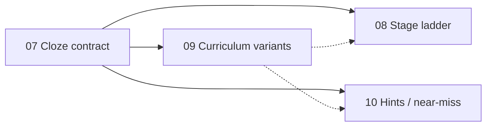

# Grammar review redesign — multi-plan overview

**Source:** [_bmad-output/brainstorming/brainstorming-session-2026-07-11-1800.md](../../_bmad-output/brainstorming/brainstorming-session-2026-07-11-1800.md)

**Verdict:** Grammar reviews must test **placement in context** (Bunpro-like JP cloze), not kanji-style reading of the surface form. One universal cloze system; difficulty = input mode + scaffolding by SRS stage.

## Locked review matrix

| Stage | Prompt | Answer | English / hints |
|--------|--------|--------|-----------------|
| `< Guru` | JP cloze · variants | MC · same-family distractors | Nudge → EN; no SRS penalty |
| Guru → Master | JP cloze · variants | Type-in chunk | Nudge → EN; no SRS penalty |
| Enlightened+ | JP cloze · variants | Type-in chunk | **No English**; nudge only or none |

## Focused plans

| # | Plan | Focus | Priority |
|---|------|--------|----------|
| [07](07-grammar-cloze-contract.md) | Cloze contract | Kill は→は; JP cloze with blank = variable chunk | **P0** |
| [08](08-grammar-stage-ladder.md) | Stage ladder | MC → type-in; Enlightened scaffolding gate | P1 |
| [09](09-grammar-cloze-curriculum.md) | Curriculum variants | Schema, 5 variants, grammar families, compile | P2 (long pole) |
| [10](10-grammar-hints-and-nearmiss.md) | Hints & near-miss | Two-rung hints; incomplete = incorrect + teach | P1 |

## Suggested sequencing

1. **Plan 07 first** — playtest stopper. Interim cloze from existing `example_sentences`.
2. **Plan 08 + Plan 10 in parallel** after 07 — UI/input vs feedback; share `englishHintsAllowed(stage)`.
3. **Plan 09 in parallel with 08/10** — schema + Wave A particle authoring; swap interim derivation when ready.

## Shelved (do not implement)

- Image + Japanese question Guru production
- Full EN → JP sentence production as Enlightened mode
- Enlightened 50/50 cloze + EN→JP mix
- Live Google Image Search for review images

## Current code anchors

| Concern | Location |
|---------|----------|
| Grammar always `production` | `mobile/src/core/srs/promptResolver.ts` |
| Tautological prompt UI | `ReviewCard` shows `primaryForm` (`は`) |
| Grammar grading | `mobile/src/core/grammar/answerEvaluator.ts` |
| Hints | `hintLevels.ts` + `ProgressiveHint` |
| Stage labels | `mapFsrsStateToStageLabel` in `fsrsScheduler.ts` |
| Examples (unused in review) | `example_sentences` via `itemRepository` |
| No MC UI | — |

## Relationship to earlier feedback plans

- **Plan 04** (grammar in lessons) — prerequisite; marked done in working history. Without it, these review plans never get playtested.
- **Plan 02 / 03** — session re-queue and answer validation stay as-is; grammar cloze plugs into the same session/evaluator pipeline.
- **Plan 02 Option B** (split SRS by prompt type) — still deferred; grammar stays one card with stage-scaled *input*, not split meaning/reading cards.
